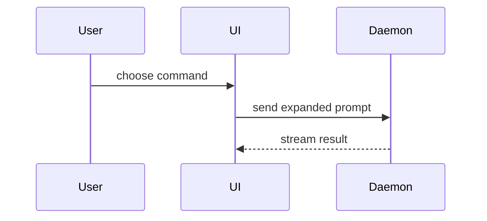

The issue is where a thought that arrived mid-task waits for later development. Record the idea raw, exactly as it arrived: design waits until the issue is picked up — a solution sketched here anchors the future fix on a path nobody chose. This template is for such ideas alone; bug reports and task tracking keep their own formats. Title the issue in one line, then use this template for the body:

```markdown
## Idea

<the thought as it arrived — what it wants and why>

## Spark

<what you were doing, and what you noticed>

## Shape

<the picture the idea arrived with, or the observation behind it>
```

## Sections

Skip all preambles and keep prose brief. Use the user's domain language from `GLOSSARY.md`.

### Idea

The raw thought in the user's own words: what it wants and why it matters. Anything about how to build it — the solution's shape, acceptance criteria — is design, and design waits for pickup.

### Spark

The observation behind the thought: the work it interrupted and what you noticed there. A few lines — enough that a reader who wasn't there sees where the idea came from.

### Shape

Show the idea as it arrived — the picture the thought came with, or the observation behind it; the solution is designed when the issue is picked up. Omit this section when the idea is words only. Pick the smallest view that shows the idea:

- Show logic or an algorithm as pseudocode:

```text
on(save)
  if content is unchanged
    return cached result
  write new content
  return fresh result
```

- Show runtime control flow as a call tree:

```text
submitForm
  createSession
    persistPrompt
    launchAgent
  navigateToSession
```

- Show UI structure as a component tree, including state and module boundaries that matter:

```tsx
<SessionPage> (apps/example/src/routes/session.tsx)
  useSessionEvents()
  <SessionToolbar>
    <RunSkillButton> (packages/ui)
```

- Show file responsibility or a broad refactor as a shallow file tree:

```text
src/
├── commands/       # parses user actions
├── sessions/       # owns session state
└── transport/      # sends API requests
```

- Show component interaction, control flow, or data flow with Mermaid:



- Use `diff` when the point is what changes and the surrounding shape already exists. Match the diff shape to the topic.

For a component change:

```diff
 <SessionPage>
   useSessionEvents()
   <SessionToolbar>
+    <RunSkillButton />
   <SessionTimeline>
+    <SkillResultCard />
```

For a file-layout change:

```diff
 src/
 ├── commands/
+│   └── show-me.ts       # expands the slash command
 ├── sessions/
-└── transport.ts
+└── transport/
+    ├── client.ts
+    └── stream.ts
```

For a call-tree or call-stack change:

```diff
 submitForm
   createSession
     persistPrompt
+    expandSkillMention
     launchAgent
-  navigateToSession
+  navigateToSession
+    subscribeToEvents
```

For a state or control-flow change:

```diff
 on(save)
-  write content
+  if content is unchanged
+    return cached result
+  write new content
+  invalidate cache
```

Place each visual next to the short text it supports; keep only the calls, files, props, states, and boundaries the idea is about. You may use one of these, you may use several, it is unlikely you will use all of them — use your judgement and don't overwhelm the reader.
