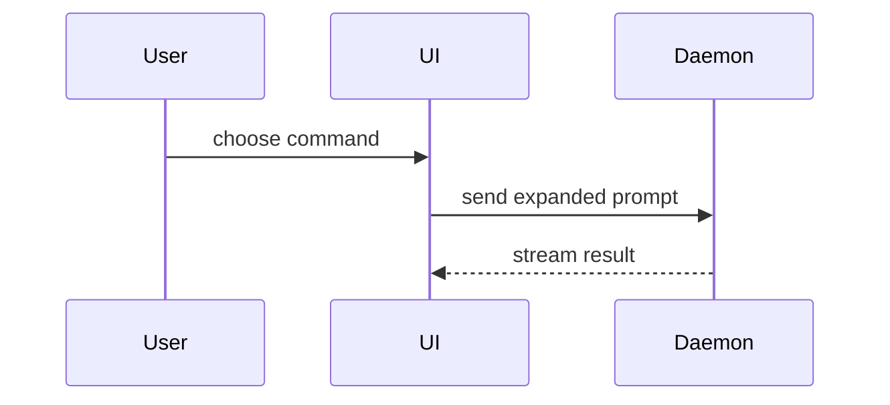

The issue is a parking spot for a thought that arrived mid-task: capture what will not survive the session, defer polish to pickup. This layout serves that parking alone — bug reports and task tracking keep their own formats. Title the issue in one line, then use this template for the body:

```markdown
## Proposal

<what should exist or change, and why it matters — essence first>

## Context

<the work in progress the idea interrupted, what triggered it, the code it touches>

## Shape

<the smallest view that makes the proposal concrete>

## Open Questions

- <undecided point>

## Done When

- <checkable outcome>
```

## Sections

Skip all preambles and keep prose brief. Use the user's domain language from `GLOSSARY.md`.

### Proposal

The first sentence carries the whole essence — a cold reader triages from it and the title alone. Expand only what the essence leaves out.

### Context

Record the state that evaporates when the session ends: the work the idea interrupted, the observation that triggered it, and the code it touches. Name the workstream it attaches to so it lands in later development deliberately. A reader who wasn't there must be able to start cold.

### Shape

Pick the smallest view that makes the proposal concrete:

- Show logic or an algorithm as pseudocode:

```text
on(save)
  if content is unchanged
    return cached result
  write new content
  return fresh result
```

- Show runtime control flow as a call tree:

```text
submitForm
  createSession
    persistPrompt
    launchAgent
  navigateToSession
```

- Show UI structure as a component tree, including state and module boundaries that matter:

```tsx
<SessionPage> (apps/example/src/routes/session.tsx)
  useSessionEvents()
  <SessionToolbar>
    <RunSkillButton> (packages/ui)
```

- Show file responsibility or a broad refactor as a shallow file tree:

```text
src/
├── commands/       # parses user actions
├── sessions/       # owns session state
└── transport/      # sends API requests
```

- Show component interaction, control flow, or data flow with Mermaid:



- Use `diff` when the point is what changes and the surrounding shape already exists. Match the diff shape to the topic.

For a component change:

```diff
 <SessionPage>
   useSessionEvents()
   <SessionToolbar>
+    <RunSkillButton />
   <SessionTimeline>
+    <SkillResultCard />
```

For a file-layout change:

```diff
 src/
 ├── commands/
+│   └── show-me.ts       # expands the slash command
 ├── sessions/
-└── transport.ts
+└── transport/
+    ├── client.ts
+    └── stream.ts
```

For a call-tree or call-stack change:

```diff
 submitForm
   createSession
     persistPrompt
+    expandSkillMention
     launchAgent
-  navigateToSession
+  navigateToSession
+    subscribeToEvents
```

For a state or control-flow change:

```diff
 on(save)
-  write content
+  if content is unchanged
+    return cached result
+  write new content
+  invalidate cache
```

A proposal already concrete in its text needs no view. Place each visual next to the short text it supports; keep only the calls, files, props, states, and boundaries needed to make the proposal concrete. You may use one of these, you may use several, it is unlikely you will use all of them — use your judgement and don't overwhelm the reader.

### Open Questions

One decision per line, with the options in play. Omit the section when nothing is undecided.

### Done When

One checkable outcome per line. Every behavior the proposal implies appears here; the issue closes when all of them hold.
